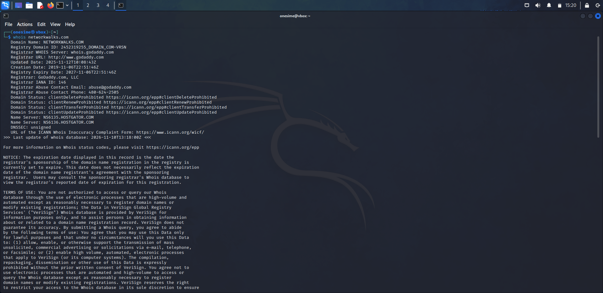
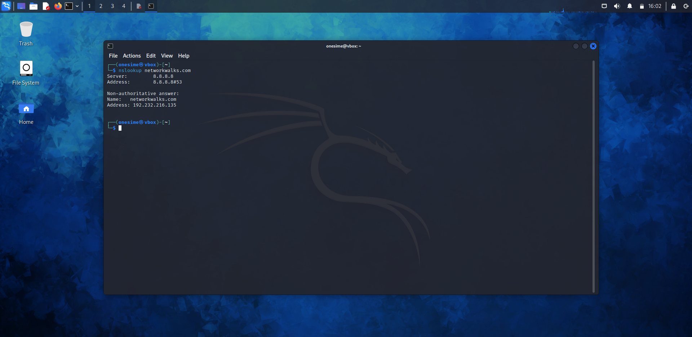
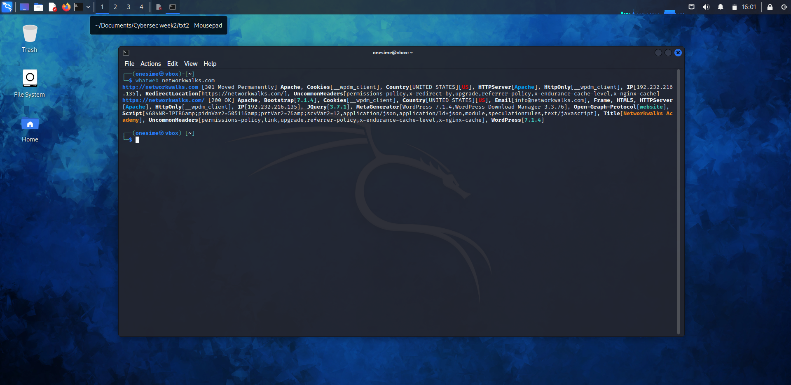
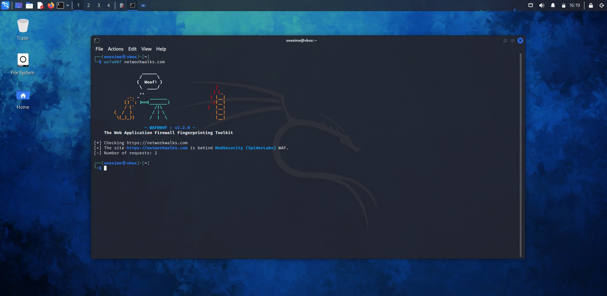
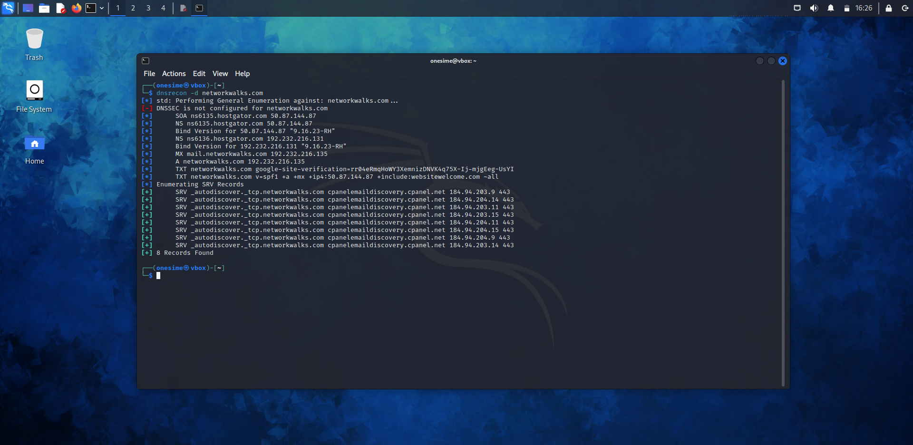
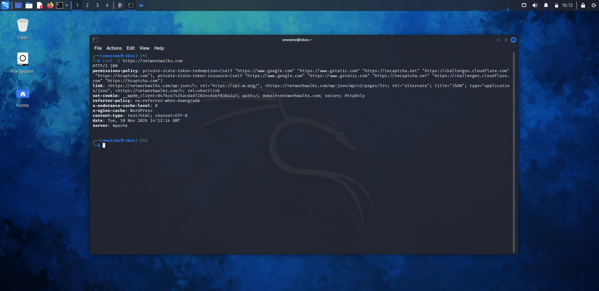
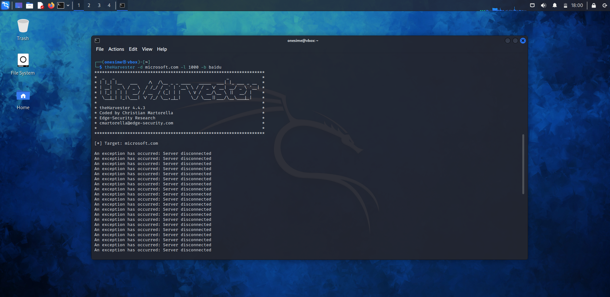
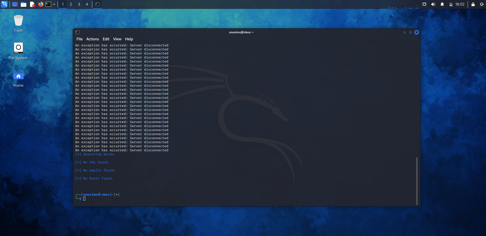

# 🎯 Week 2: Footprinting & Reconnaissance with Kali Linux Tools

**Passive and active reconnaissance of a live website and network using built-in Kali Linux tools.**

---

## 📌 Project Overview

Reconnaissance (footprinting) is the first step in any real attack or security test. Before touching a target, an attacker (or security auditor) collects as much public information about it as possible: who owns the domain, its real IP address, the hosting provider, the web technologies it runs, its DNS and mail records, and whether a Web Application Firewall is protecting it.

This repository documents my practical work for Week 2 of the NetworkWalks Cybersecurity & Penetration Testing training. It covers gathering intelligence on a target using various Kali Linux tools, followed by network scanning to discover active hosts and services using Zenmap.

---

## 🎯 Objectives

*   Find the domain registration details with `whois`
*   Fingerprint the web technologies with `whatweb`
*   Resolve the domain to its IP address with `nslookup`
*   Read the HTTP response headers with `curl -I`
*   Detect a Web Application Firewall with `wafw00f`
*   Enumerate DNS records with `dnsrecon`
*   Gather open-source intelligence (OSINT) like emails and subdomains with `theHarvester`
*   Discover active hosts and open ports on a network using `Zenmap` (Nmap GUI)
*   Record every output with screenshots and text files

---

## 🛠️ Lab Environment & Tools

| Component | Configuration / Tools Used |
| :--- | :--- |
| **Operating System** | Kali Linux |
| **Virtualization** | Oracle VirtualBox |
| **Web Recon Tools** | `whois`, `whatweb`, `nslookup`, `curl`, `wafw00f`, `dnsrecon`, `theHarvester` |
| **Network Scanning** | `Zenmap` (Nmap GUI) |
| **Documentation** | Terminal screenshots, text files, and network topology graphs |

---

## 📸 Walkthrough & Screenshots

*(Assurez-vous d'avoir créé un dossier "screenshots" dans votre dépôt et d'y avoir placé vos images)*

### 1. Passive & Active Footprinting
Here are the results of the information gathering phase using Kali Linux terminal tools.

**WHOIS & Nslookup (Domain & IP Info)**

**WhatWeb & WAF Detection (Web Fingerprinting)**

**DNS Enumeration & HTTP Headers**

**OSINT Gathering with theHarvester**

### 2. Network Scanning with Zenmap
Transitioning from web recon to network discovery, I used Zenmap to perform Ping Scans and identify active hosts, open ports, and running services.

**Host Discovery & Port Scanning**

**Network Topology Visualization**

---

## 🧠 Lessons Learned

1.  **Reconnaissance is critical:** It establishes a solid understanding of the target before any further assessment.
2.  **OSINT Value:** Publicly available information can reveal potential security exposures (e.g., leaked emails via theHarvester).
3.  **DNS & Web Insights:** DNS enumeration and HTTP header inspection provide invaluable clues about an organization's infrastructure and web app configurations.
4.  **Context is Key:** Open ports found via Zenmap are not necessarily vulnerabilities, but they expose services that require further investigation.
5.  **Tool Interpretation:** Understanding how to interpret tool outputs is just as important as knowing how to operate the tools.

---

## ⚠️ Important Notes

*   **Authorization:** Always perform footprinting and scanning strictly within an authorized scope.
*   **Ethics:** Publicly available information can still present security risks if not properly secured by the organization. 

---
*Disclaimer: This project was conducted in a controlled lab environment as part of an educational training program.*
